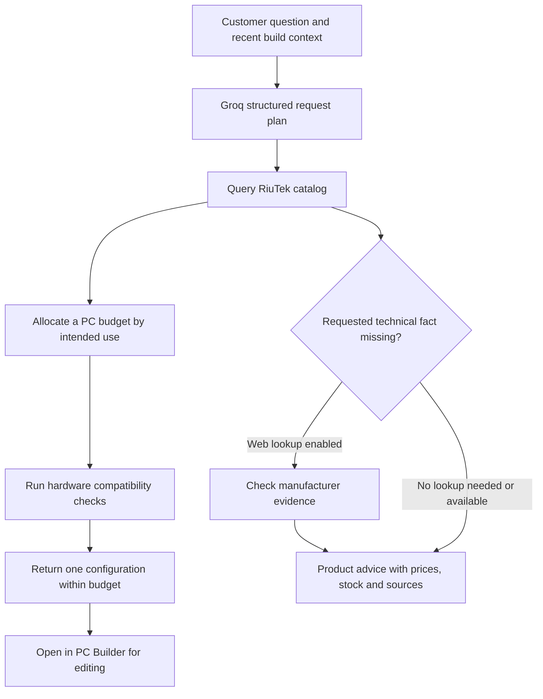
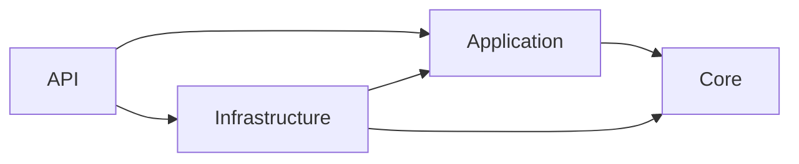

<div align="center">
  
  <h1>RiuTek API</h1>
  <p>PC component shopping &amp; custom builds</p>
  <p>
    <a href="https://riutek.store">Live website</a> &nbsp;·&nbsp;
    <a href="https://github.com/RiuTek/RiuTek_Web">Frontend repository</a> &nbsp;·&nbsp;
    <a href="#run-locally">Local setup</a>
  </p>


[](https://github.com/RiuTek/RiuTek_API/actions/workflows/ci-acr.yml)

</div>

---

RiuTek is a personal e-commerce project that helps customers buy PC components and choose parts for a custom build. This repository contains the backend for the catalog, hardware compatibility checks, AI shopping assistant, accounts, checkout, payments and store administration.

> **Demo scope** — The application is deployed for portfolio demonstrations. Stripe uses test mode.

[Features](#features) · [AI assistant](#ai-assistant) · [Architecture](#architecture) · [Technology](#technology) · [Setup](#run-locally) · [Testing](#build-and-test) · [Deployment](#deployment) · [Roadmap](#roadmap)

## Features

| Feature | Implemented capabilities |
| :--- | :--- |
| **Accounts** | JWT authentication, rotating refresh tokens in HttpOnly cookies, profiles, delivery addresses and Customer/Staff/Admin permissions. |
| **Catalog** | nested categories, nine component types, structured hardware specifications, keyword search, technical filters, sorting and pagination. |
| **PC Builder** | anonymous compatibility previews, customer saved configurations, quantity-aware checks, build-to-cart and direct build checkout. Compatibility findings are advisory; price, availability and stock are checked separately when purchasing. |
| **AI assistant** | Vietnamese product advice grounded in the live catalog, up to three component recommendations, optional manufacturer-source lookup, and one PC configuration based on use and budget. Follow-up requests can keep a CPU, change a GPU or reduce the budget. |
| **Cart and checkout** | authenticated persistent carts, version checks, checkout of selected cart items, Buy Now for individual products or saved builds, checkout quotes and idempotent order creation. Inactive carts are cleaned up after 30 days. |
| **Orders and payments** | customer order history/cancellation, staff fulfillment actions, COD and Stripe Checkout in test mode. Signed Stripe webhooks handle payment events and stock restoration where applicable. |
| **Inventory** | stock movement history and manual adjustments with concurrency checks. Creation, import, checkout, cancellation and payment expiration record their stock changes. |
| **Product imports and media** | downloadable Excel templates, workbook inspection, validation before import and transactional create-only imports. Images uploaded to Cloudflare R2 can be mapped to workbook products by SKU. |
| **Content** | post/comment APIs, purchased-product reviews with ratings and moderation, and homepage banner management. Banner images reuse the R2 upload flow; referenced media is protected from deletion. |

Posts, comments and reviews are implemented as backend APIs; their customer-facing frontend screens are not part of the current web release. PNG export is implemented by the frontend in the browser, without an export API or stored image.

## AI assistant

The storefront's floating chat uses `POST /api/v1/ai/ask`. Customers with active accounts, Staff and Admin can use it while guest access is disabled through `Ai__AllowAnonymous=false`.



**Product advice.** Groq interprets the question, and the application queries actual catalog records for products, prices and availability. Recommendations are filtered by the understood requirements and limited to three items. Optional web lookup supplies missing technical facts after checking that the evidence matches the requested model. Unresolved facts are reported as such. Store-policy answers depend on approved FAQ entries, which are currently empty.

**PC recommendations.** The application allocates the available budget according to office, gaming or content-creation use, then searches a bounded candidate set and runs the existing compatibility service. Required and already-owned parts are preserved, and owned parts are excluded from the shopping total. Budget ranking uses catalog prices and specifications, with heuristic priorities for CPU, GPU, memory and storage.

**Follow-up changes.** The client sends the previous configuration's product IDs and constraints. The backend resolves those IDs against the database and checks current prices, availability, budget and compatibility again. Keeping a part preserves its exact model and whether the user marked it as already owned. The frontend can open the result as an editable PC Builder draft.

These recommendations use catalog specifications and price tiers. Benchmark-based performance predictions and FPS estimates are future work.

**Usage controls.** Redis reserves quotas atomically. The default limits are 10 questions per account per 15 minutes, 50 customer questions shared across all customer accounts per UTC day, 200 provider requests per UTC day and 30 web lookups per UTC day. A question can consume more than one provider request. Exhausted limits return HTTP `429` with `Retry-After`; unavailable quota storage blocks AI requests. Limits can be overridden through runtime configuration.

## Architecture

The backend is a modular monolith with Clean Architecture. Application features are organized as vertical slices using CQRS and MediatR.



*Arrows represent project dependencies.*

| Layer | Responsibility |
| :--- | :--- |
| `Core` | Entities, component specifications and business rules |
| `Application` | Commands, queries, validators, DTOs and integration interfaces |
| `Infrastructure` | EF Core, PostgreSQL, Redis, authentication, Groq, Stripe and R2 adapters |
| `API` | HTTP contracts, controllers and application startup |

Core does not depend on the outer layers. Application depends on Core; Infrastructure implements the interfaces used by Application. API composes the application and infrastructure services.

Expected business failures use Result/Error responses. FluentValidation runs in the MediatR pipeline, DTOs are mapped explicitly, and handlers enforce account/ownership checks in addition to endpoint authorization. Checkout revalidates prices and stock; idempotency and concurrency checks address repeated or competing requests.

## Technology

| Area | Stack |
| --- | --- |
| API | .NET 10, ASP.NET Core, C# |
| Application | MediatR, FluentValidation, CQRS |
| Database | PostgreSQL, EF Core 10, Npgsql |
| Authentication | JWT Bearer, BCrypt, refresh-token rotation |
| Integrations | Redis, Stripe Checkout, Cloudflare R2/S3 API, ClosedXML |
| AI | GroqCloud HTTP API, structured JSON plans, catalog queries, manufacturer-source verification |
| Testing | xUnit, FluentAssertions, PostgreSQL Testcontainers |
| Deployment | Docker, GitHub Actions, Azure Container Registry, Azure App Service |

The database includes pgvector support for future embedding search. Current AI retrieval uses catalog queries and structured specification filters.

## Run locally

**Prerequisites**

- .NET 10 SDK.
- PostgreSQL with the `vector` extension enabled.
- EF Core CLI matching the project's EF Core version.
- Docker for PostgreSQL integration tests; an existing local PostgreSQL instance is sufficient to run the API.

From the repository root, configure a local database and a random JWT signing key in the terminal environment. The JWT key must contain at least 32 UTF-8 bytes; length alone does not guarantee randomness. Do not use production credentials for local development.

PowerShell 7.1 or newer:

```powershell
$env:DOTNET_ENVIRONMENT = "Development"
$env:ASPNETCORE_ENVIRONMENT = "Development"
$env:ConnectionStrings__DefaultConnection = Read-Host "Local PostgreSQL connection string" -MaskInput
$env:JwtSettings__SecretKey = Read-Host "Random JWT signing key" -MaskInput
$env:RedisSettings__Enabled = "false"
$env:Stripe__Enabled = "false"
$env:R2__Enabled = "false"
$env:CartCleanup__Enabled = "false"
$env:Ai__Enabled = "false"

dotnet restore RiuTek_API.slnx
dotnet ef database update --project RiuTek.Infrastructure --startup-project RiuTek.API
dotnet run --project RiuTek.API --no-launch-profile
```

Install the matching dotnet-ef tool if it is not already available. Use the local URL printed by the application. In Development, the OpenAPI document is served at /openapi/v1.json. For refresh-cookie authentication, use HTTPS: refresh cookies are always Secure and HttpOnly. Do not weaken cookie settings to make local HTTP authentication work.

Environment variables set in this terminal apply to that process and its child processes; they do not permanently update User/Machine settings. Redis, Stripe and R2 are optional for local startup. Background cart cleanup is disabled in the example to avoid a startup sweep during setup.

<details>
<summary><strong>Optional integrations and environment variables</strong></summary>


Configure these only when enabling the corresponding integration:

| Service | Environment variable names |
| --- | --- |
| Redis | RedisSettings__Enabled, RedisSettings__ConnectionString |
| Stripe test mode | Stripe__Enabled, Stripe__SecretKey, Stripe__WebhookSecret, Stripe__SuccessUrl, Stripe__CancelUrl |
| Cloudflare R2 | R2__Enabled, R2__ServiceUrl, R2__PublicBaseUrl, R2__BucketName, R2__AccessKeyId, R2__SecretAccessKey |
| Groq AI | Ai__Enabled, Ai__Groq__ApiKey, Ai__Groq__Model, Ai__AllowAnonymous, Ai__WebSearchEnabled |
| AI limits | Ai__Limits__TurnsPer15Minutes, Ai__Limits__CustomerTurnsPerDay, Ai__Limits__ProviderRequestsPerDay, Ai__Limits__WebRequestsPerDay |

Keep secrets in runtime environment settings, outside source control. See the configuration classes for optional non-secret limits and timeouts. Never put backend credentials in the frontend's public VITE variables.

AI requires Redis for quota checks and a Groq API key supplied at runtime. Set `Ai__AllowAnonymous=false` for the signed-in experience. Enable web lookup only with a provider model that supports the configured browser-search tool. The Groq key belongs in the backend's Azure environment settings when deployed.

</details>

## Build and test

```powershell
dotnet build RiuTek_API.slnx -c Release
dotnet test RiuTek.Application.Test/RiuTek.Application.Test.csproj -c Release
dotnet test RiuTek.API.IntegrationTest/RiuTek.API.IntegrationTest.csproj -c Release
```

The integration tests start an isolated PostgreSQL/pgvector container and apply migrations. They do not use the production Supabase database. External services are replaced with test implementations where appropriate. AI tests cover budget allocation, revisions, owned parts, evidence parsing, account eligibility and quotas, including HTTP revision requests against PostgreSQL with changed catalog prices.

## Deployment

```powershell
docker build -f RiuTek.API/Dockerfile -t riutek-api:local .
```

The image runs the API as a non-root user on port 8080. Supply configuration at runtime; do not include secrets in the image. GET /health/live checks process liveness, not database or external-service readiness.

Pushes to master run the GitHub Actions workflow: build and tests, Docker build/push to ACR using the commit SHA, EF migrations to Supabase, deployment to Azure App Service, and HTTP smoke checks. The deployed application uses Supabase PostgreSQL, Upstash Redis and Cloudflare R2. Credentials are supplied through GitHub/Azure settings.

The frontend is deployed separately on Vercel and proxies API requests through /api/v1. See the frontend repository for browser setup and deployment details.

## Roadmap

This is a personal portfolio project. Stripe runs in test mode; the deployed site is intended for demonstrating the workflows, not claiming a live retail operation.

Planned additions:

- Customer-facing posts, comments and reviews screens, using the existing APIs.
- Embedding-based semantic product search with pgvector.
- Benchmark-backed ranking and more detailed application/game-specific PC recommendations.
- VNPay integration and broader return/refund workflows.
- Laptop and prebuilt-PC catalog support as independent stocked products, without component-level stock or compatibility rules for those products.
